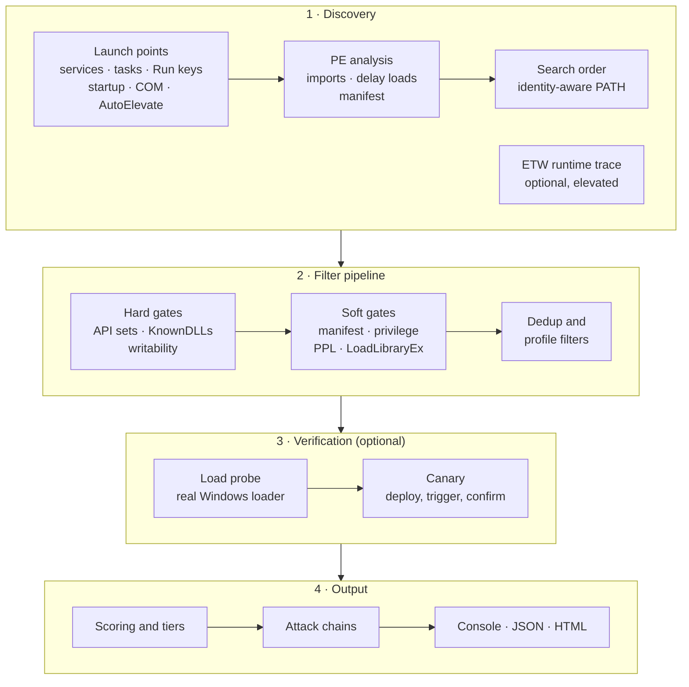
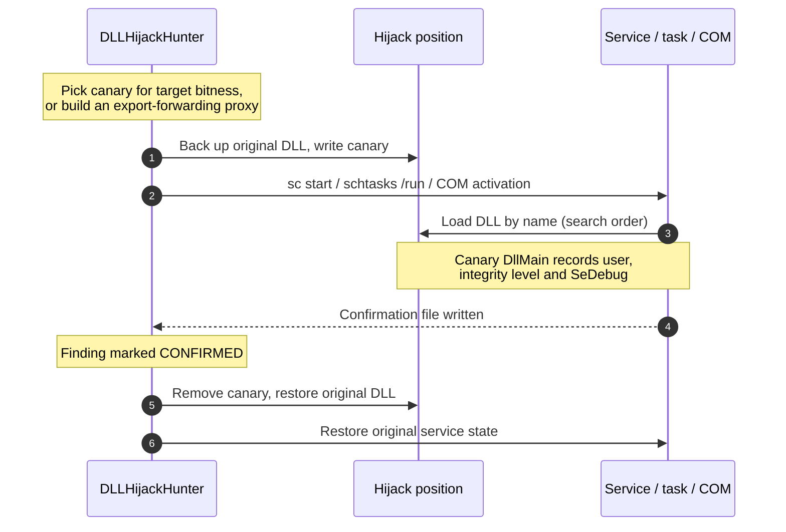

<p align="center">
  
  
  
  
  
  
</p>

<h1 align="center">DLLHijackHunter</h1>
<h4 align="center">By <a href="https://projectmerai.com">ProjectMerai</a></h4>

<p align="center">
  <strong>Automated DLL hijacking discovery, validation, and confirmation for Windows</strong><br/>
  <em>From "this DLL might be hijackable" to "a standard user can make SYSTEM load this — here is the proof."</em>
</p>

---

## Contents

- [Overview](#overview)
- [Quick start](#quick-start)
- [How it works](#how-it-works)
- [What it detects](#what-it-detects)
- [Reducing false positives](#reducing-false-positives)
- [Verification: load probe and canary](#verification-load-probe-and-canary)
- [Scoring, tiers, and attack chains](#scoring-tiers-and-attack-chains)
- [Usage reference](#usage-reference)
- [Safety and operational impact](#safety-and-operational-impact)
- [Building from source](#building-from-source)
- [Test lab (HijackRange)](#test-lab-hijackrange)
- [Known limitations](#known-limitations)
- [Comparison](#comparison)

---

## Overview

DLLHijackHunter finds DLL hijacking opportunities on a Windows host and works to prove them, not just list them. It:

1. **Discovers** every place a binary is launched automatically — services, scheduled tasks, Run keys, Startup folders, COM servers, AppInit/AppCert DLLs, IFEO entries, and auto-elevating UAC binaries — and computes where each imported DLL would be searched for.
2. **Filters** out positions an attacker cannot actually use: API sets, KnownDLLs, directories a standard user cannot write, protected processes, and more.
3. **Verifies** (optional) with the real Windows loader, by placing a benign probe DLL and checking which copy wins the search.
4. **Confirms** (optional) by deploying a harmless canary DLL, triggering the service/task/COM object, and recording the identity it actually ran as.
5. **Scores and reports** each finding by confidence and impact, and correlates findings into attack chains (for example *standard user → SYSTEM*).

Every judgement is made **from the attacker's point of view** — an unprivileged standard user — regardless of whether the scanner itself runs elevated. Running as Administrator gives the tool more visibility (ETW, canary, service triggers); it never makes protected directories look writable or inflates the privilege gained.

---

## Quick start

Download or build `DLLHijackHunter.exe` (self-contained; no .NET install needed), then from an **elevated** prompt:

```powershell
# Passive, read-only triage: no file drops, no service/task starts
.\DLLHijackHunter.exe --profile safe

# Full static analysis without touching the system, JSON report
.\DLLHijackHunter.exe --profile aggressive --no-canary --no-etw -o report.json

# Static analysis + real-loader verification (writes probe DLLs transiently)
.\DLLHijackHunter.exe --profile aggressive --no-canary --no-etw --verify-load -o report.html

# Everything, including ETW and canary confirmation — lab / authorised targets only
.\DLLHijackHunter.exe --profile aggressive -o report.html

# Focus on one application
.\DLLHijackHunter.exe --target "C:\Program Files\MyApp\app.exe" --no-canary
```

> **Antivirus:** the canary and probe DLLs are unsigned and behave like hijack payloads, so Microsoft Defender may quarantine them. The tool detects this and reports those results as **inconclusive** rather than "not hijackable". On a test machine, exclude the target directories and `%ProgramData%\DLLHijackHunter` to get definitive results.

---

## How it works



| Phase | Requires admin | Modifies the system |
|---|:---:|---|
| Static discovery + filters | No (admin sees more) | No |
| ETW runtime discovery | **Yes** | **Starts** auto-start services (up to 100) and runs scheduled tasks (up to 30) to provoke DLL loads |
| Load probe (`--verify-load`) | No | Briefly writes a benign probe DLL at each candidate position, then removes it and restores any original |
| Canary confirmation | **Yes** | Writes a canary DLL, stops/starts services, runs tasks, activates COM objects, then cleans up |

---

## What it detects

### Hijack types

| Type | What it means | Notes |
|---|---|---|
| **Phantom** | The DLL does not exist anywhere in the search path | Plant it anywhere the binary searches |
| **Search order** | A writable directory is searched before the legitimate copy | Includes overwriting a DLL in a writable directory |
| **ENV PATH** | A writable directory in `PATH` is searched for a missing DLL | Services are evaluated against the **machine** PATH only — the user's own PATH entries are never searched by a service |
| **.local redirect** | `<app>.exe.local\<dll>` redirection | Only reported for executables **without a manifest** (or when IFEO `DevOverrideEnable=1`); the loader ignores `.local` otherwise, and it never redirects KnownDLLs |
| **Side-load (UAC)** | Copy an auto-elevating EXE next to a planted DLL | Only for EXEs with `<autoElevate>true</autoElevate>` in their manifest. Auto-elevation requires a trusted location, so the copy must pass that check (e.g. a mock `C:\Windows \System32\` folder) |
| **AppInit DLLs** | `AppInit_DLLs` points to a writable DLL | Loaded into every process that loads `user32.dll` |
| **AppCert DLLs** | `AppCertDLLs` points to a writable DLL | Loaded into every `CreateProcess`/`WinExec` caller |

IFEO `Debugger` and `SilentProcessExit\MonitorProcess` binaries are enumerated and analysed like any other launch point. CWD-based hijacks are not currently produced.

### Who the target runs as

Correct identity drives both the privilege-escalation verdict and the impact score:

- **Services** — `ObjectName` (LocalSystem, Local Service, Network Service, or an account); svchost services also analyse their `ServiceDll`.
- **Scheduled tasks** — the task principal. SID forms such as `S-1-5-18` are mapped to `NT AUTHORITY\SYSTEM`; group principals run as the logged-on member (only *Administrators + highest privileges* counts as elevated). Payloads wrapped in `rundll32`, `cmd /c`, or `powershell -File` are analysed too.
- **Run keys / Startup folders** — enumerated for **every loaded user profile** (`HKEY_USERS`) and every profile's Startup folder, attributed to that user — not just the account running the scanner.
- **COM** — out-of-process servers follow `AppID` → `RunAs` / `LocalService`; in-process servers run as whichever client loads them.

### Knowledge base and PATH weaponisation

- A bundled snapshot of the **[HijackLibs](https://hijacklibs.net/)** dataset (≈590 DLLs across ≈700 executables, `Resources/hijacklibs.json`) is cross-referenced. A match raises confidence and links the reference; no match means nothing. Refresh it by replacing the file with `https://hijacklibs.net/api/hijacklibs.json`. Dataset © the HijackLibs project and contributors.
- For each writable directory on the **machine** PATH, candidates are generated for well-known SYSTEM services that probe PATH for missing DLLs (`IKEEXT → wlbsctrl.dll`, `Spooler → ualapi.dll`, `Schedule → WptsExtensions.dll`, `SessionEnv → tsmsisrv.dll`, `WlanSvc → wlanhlp.dll`).

---

## Reducing false positives

**Hard gates** (candidate is dropped):

- **API sets** — every `api-ms-*` / `ext-ms-*` contract name is resolved through the API set schema, never the search order.
- **KnownDLLs** — read from the live `\KnownDlls` and `\KnownDlls32` object directories (not just the registry seed list), plus `ntdll.dll`, which is always mapped first.
- **Attacker-relative writability** — a position counts only if `Users`, `Authenticated Users`, `Everyone`, or `INTERACTIVE` (plus a non-privileged service account such as `LOCAL SERVICE`) holds the right that matters: **create files** for a DLL drop, **create folders** for a `.local` directory. This is computed from the ACL, independent of the scanner's own token, so an elevated scan never sees `System32`, `Program Files`, or a drive root (`C:\`) as writable.

**Soft gates** (confidence is adjusted, with the reason recorded in the finding's notes):

- **Manifest / WinSxS** binding of the DLL.
- **Privilege delta** — measured against a **standard-user attacker**: SYSTEM, LOCAL/NETWORK SERVICE, and UAC-elevated targets are privilege escalation; same-privilege targets are kept as persistence / defence-evasion findings.
- **LoadLibraryEx mitigations** — `SetDefaultDllDirectories`, `AddDllDirectory`, `SetDllDirectory` imports.
- **Protected processes** — known PPL binaries, services with `LaunchProtected` set in the SCM configuration (covers new Windows and third-party AV/EDR services), and `FORCE_INTEGRITY` images.
- **Error-handled optional loads.**

If a gate fails to evaluate, the candidate is not penalised, but the failure is recorded in its notes and the log rather than hidden.

---

## Verification: load probe and canary

### Load probe (`--verify-load`)

For Phantom, Search-order, and Side-load candidates, a benign probe DLL is copied to the writable position and a short-lived child process asks the **real Windows loader** to resolve the name:

| Result | Meaning | Effect |
|---|---|---|
| **Wins** | The loader picked the writable position | Search order proven; finding may reach **High** |
| **LosesToProtected** | A KnownDLL, System32, or SxS copy won instead | Likely false positive; −40 confidence |
| **NotResolved** | The name did not resolve; the loader error is recorded | Inconclusive |
| **Error** | The probe could not run — including the probe being **quarantined by antivirus** | Inconclusive, no penalty |
| **Skipped** | `.local`, PATH, AppInit/AppCert use different mechanics | — |

The probe models where the position really sits: a DLL in the binary's **own directory** is tested ahead of System32 (as the loader does); other positions use the classic or modern search order as appropriate. Runs as a standard user; every probe is removed and any original file restored.

### Canary confirmation



- **No compiler needed.** Precompiled x64/x86 canaries are embedded; when the hijacked DLL has exports, an export-forwarding proxy is synthesised at runtime by PE surgery so the host keeps working.
- **Self-locating.** The canary derives its confirmation path (`%ProgramData%\DLLHijackHunter\canary_<hash>.confirm`) from its own load path, so one binary serves every candidate.
- **No payload.** It only records who loaded it. Source: `src/DLLHijackHunter/Resources/canary_src.c` (rebuild with `Resources/build_canary.bat`, MSVC required only for that).
- **Results:** `Fired`, `Timeout` (triggered, never loaded), `Failed` (could not trigger/deploy), `Blocked` (canary quarantined by antivirus — inconclusive), `NotTested` (Run keys, Startup, UAC bypass, and manual targets need a logon/reboot).
- **COM caveat:** in-process COM objects are activated from a scanner-launched client, so a fired canary proves the load but its identity is the scanner's — it is recorded as *caller context* and does not inflate impact.

Proxy canaries can still be inconclusive for ordinal-only exports, decorated export names, or hosts that need the real DLL resident. An inconclusive canary does **not** mean the hijack is impossible.

---

## Scoring, tiers, and attack chains

Each finding gets a **confidence** (from the filters, probe, canary, and knowledge base) and an **impact** score (privilege gained, trigger reliability, stealth, reboot persistence), combined into a 0–10 final score.

| Tier | Requirement |
|---|---|
| **Confirmed** | Canary fired |
| **High** | ≥ 80% **and** a proof signal: probe win, ETW observation, or HijackLibs match |
| **Medium** | ≥ 50% (unverified static findings are capped here and marked `Static-only`) |
| **Low** | ≥ 20% |
| **Informational** | Below 20% but above the profile's `--min-confidence` |

**Attack chains** correlate findings into narratives:

- **Direct Path (User → SYSTEM)** — any SYSTEM finding a standard user can plant.
- **Ladder (User → Admin → SYSTEM)** — a silent UAC bypass, shown only when no direct path exists.
- **Long Con (Persistence)** — the best auto-start, non-service finding (Run key, Startup, task).

---

## Usage reference

```text
-p, --profile <name>          aggressive | strict | safe | redteam | uac-bypass   [default: aggressive]
-o, --output <path>           Write a report; format from extension (.json / .html / .htm)
-f, --format <format>         console | json | html                              [default: console]
-t, --target <target>         Binary path, directory, or file name (partial match). Scopes discovery
                              and ETW to that target and skips system-wide PATH weaponisation.
    --min-confidence <0-100>  Override the profile's threshold (only when explicitly passed)
    --no-canary               Disable canary confirmation
    --no-etw                  Disable ETW runtime discovery (no service/task starts)
    --verify-load             Real-loader verification of search order (transient probe DLLs)
    --confirmed-only          Report only canary-confirmed findings
    --lpe-only                Ignore System32 / Program Files / Windows positions
    --canary-settle <sec>     Seconds to wait for a canary to fire after triggering
    --log-file <path>         Write a diagnostic log (enumeration, filter, and probe failures)
-v, --verbose                 Verbose console output
```

### Profiles

| Profile | Purpose | Canary | ETW | AutoElevate | COM | Same-priv findings | PPL findings | Min confidence |
|---|---|:---:|:---:|:---:|:---:|:---:|:---:|:---:|
| **aggressive** | Full audit, labs | ✅ | ✅ | ✅ | ✅ | kept | kept | 15% |
| **strict** | High-confidence escalation only | ✅ | ✅ | — | — | dropped | dropped | 80% |
| **safe** | Production, read-only | — | — | — | — | kept | dropped | 50% |
| **redteam** | Confirmed escalation only (implies `--confirmed-only`) | ✅ | ✅ | — | ✅ | dropped | dropped | 50% |
| **uac-bypass** | Auto-elevation vectors | — | — | ✅ | — | dropped | dropped | 20% |

### Output

- **Console** (default): summary, tier chart, findings, attack chains. Nothing is written to disk unless you pass `--output` (a non-`.json`/`.html` path receives the JSON report when there are findings).
- **JSON / HTML**: full findings with notes, filter results, load-probe and canary results, knowledge-base references, and attack chains. A report is written even when nothing is found, so an empty file never means a failed run.

### Exit codes

| Code | Meaning |
|---|---|
| `0` | Scan completed (with or without findings) |
| `1` | Unhandled error |
| `3` | `--confirmed-only` (or the `redteam` profile) requested, but the canary cannot run — not elevated, or canary disabled. Refused instead of reporting a false "0 findings". |

---

## Safety and operational impact

Use DLLHijackHunter only on systems you own or are explicitly authorised to assess.

- `--profile safe` (or `--no-canary --no-etw`) is **read-only** — appropriate for production triage.
- **ETW mode starts services and runs scheduled tasks** to provoke DLL loads, even without the canary.
- **Canary mode** replaces DLLs (with backup/restore), stops and restarts services, runs tasks, and activates COM objects. Fragile services can misbehave while a proxy canary is loaded.
- **`--verify-load`** writes probe DLLs transiently into writable positions.
- Unsigned canary/probe DLLs may be quarantined by antivirus; such results are reported as inconclusive (`Blocked` / probe `Error`), never as "not vulnerable".

---

## Building from source

Requirements: .NET 8 SDK (and the .NET 10 SDK if you also build the `net10.0-windows` target). Building on Linux/macOS works with `-p:EnableWindowsTargeting=true`.

```powershell
git clone https://github.com/projectmerai/DLLHijackHunter.git
cd DLLHijackHunter

# Self-contained single-file executable (no .NET runtime needed on the target)
dotnet publish src/DLLHijackHunter/DLLHijackHunter.csproj `
    -c Release -f net8.0-windows -r win-x64 --self-contained `
    -p:PublishSingleFile=true -p:IncludeNativeLibrariesForSelfExtract=true `
    -o ./publish
```

The project multi-targets `net8.0-windows` and `net10.0-windows`, so `dotnet publish` needs an explicit `-f`.

---

## Test lab (HijackRange)

`HijackRange/` contains a deliberately vulnerable lab for demos and regression testing:

- **Alpha** — a SYSTEM service whose binary directory is writable by `BUILTIN\Users`.
- **Beta** — a SYSTEM scheduled task with the same pattern.
- **Gamma** — a writable directory added to the system PATH.

Build with `HijackRange\build-all.bat`, deploy with `HijackRange\setup.ps1` (elevated), and remove with `HijackRange\teardown.ps1`. See `HijackRange/demo-script.md`. Use a disposable VM.

---

## Known limitations

- **Static search order is an approximation.** Runtime behaviour (`LoadLibraryEx` flags, `SetDefaultDllDirectories`, manifests) is inferred from imports; use `--verify-load` or the canary for proof.
- **ETW** sees only processes and loads that happen during the trace window (default 120 s).
- **Persistence** ("survives reboot") is derived from auto-start configuration, not a reboot test.
- **Run keys / Startup / UAC side-load** findings cannot be canary-confirmed automatically.
- **Canary and probe DLLs are unsigned** and may be blocked by antivirus or application-control policy.

---

## Comparison

| Capability | **DLLHijackHunter** | Robber | DLLSpy | WinPEAS | Procmon |
|---|:---:|:---:|:---:|:---:|:---:|
| Automated discovery | ✅ | ✅ | ✅ | ✅ | ❌ |
| Phantom DLL detection | ✅ | ❌ | ✅ | ❌ | ✅ |
| Search-order analysis | ✅ | ❌ | ❌ | ❌ | ❌ |
| Attacker-relative ACL check | ✅ | Partial | ❌ | Basic | ❌ |
| ETW runtime monitoring | ✅ | ❌ | ❌ | ❌ | ✅ |
| Real-loader verification | ✅ | ❌ | ❌ | ❌ | ❌ |
| Canary execution proof | ✅ | ❌ | ❌ | ❌ | ❌ |
| Privilege-escalation analysis | ✅ | ❌ | ❌ | ❌ | ❌ |
| UAC bypass discovery | ✅ | ❌ | ❌ | ❌ | ❌ |
| Runtime proxy DLL generation | ✅ | ❌ | ❌ | ❌ | ❌ |
| Confidence scoring & attack chains | ✅ | ❌ | ❌ | ❌ | ❌ |
| HijackLibs correlation | ✅ | ❌ | ❌ | ❌ | ❌ |
| HTML / JSON reports | ✅ | ❌ | ❌ | TXT | ❌ |
| Self-contained binary | ✅ | ❌ | ❌ | ✅ | ❌ |

---

## License

MIT

## Credits

Built by **[ProjectMerai](https://projectmerai.com)**. Knowledge-base data from the [HijackLibs](https://hijacklibs.net/) project.
